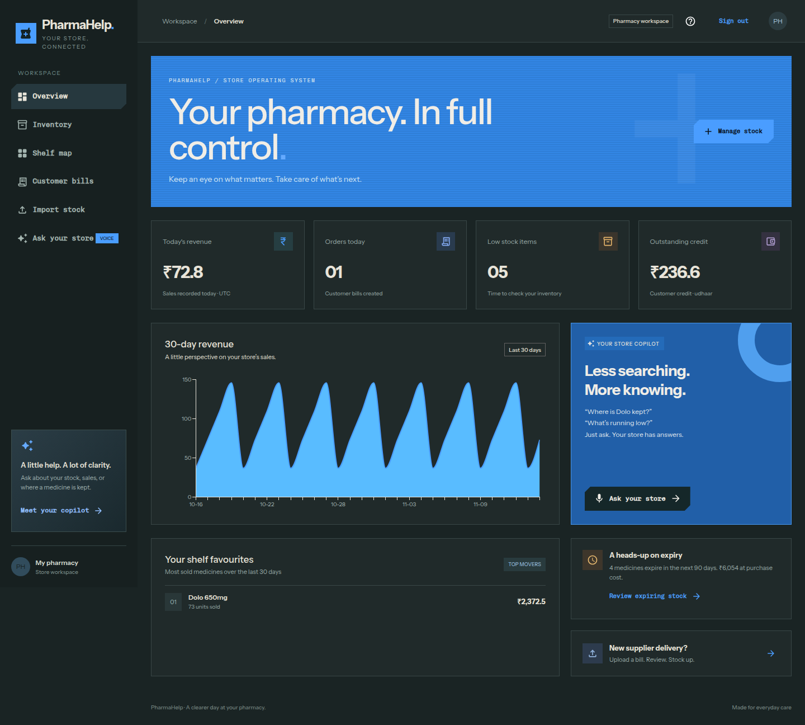
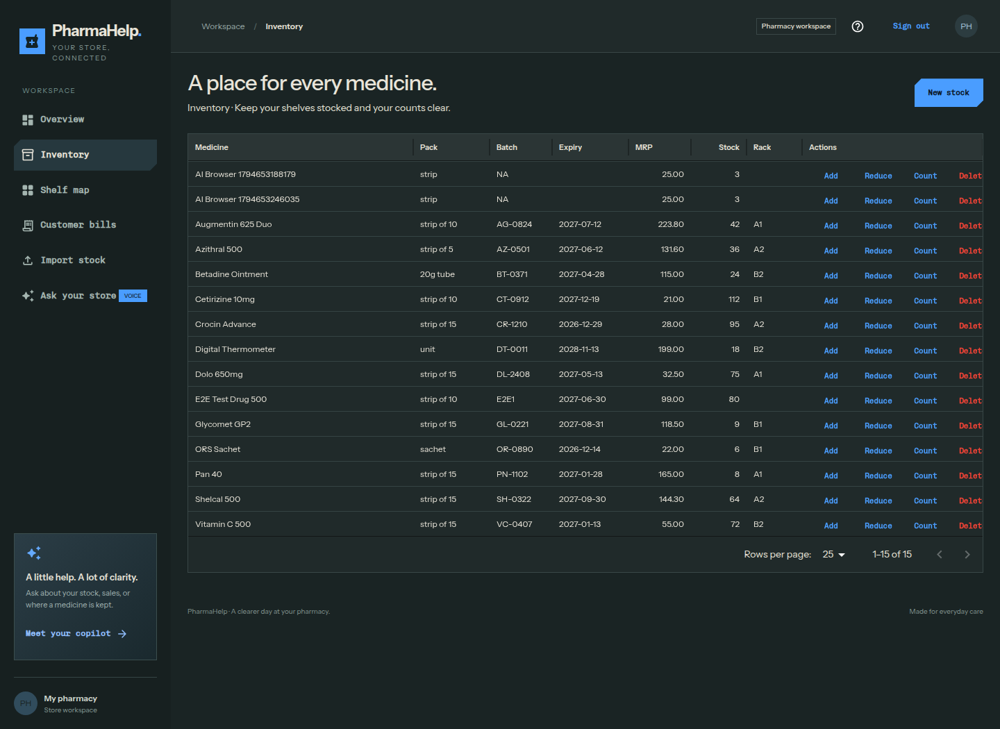
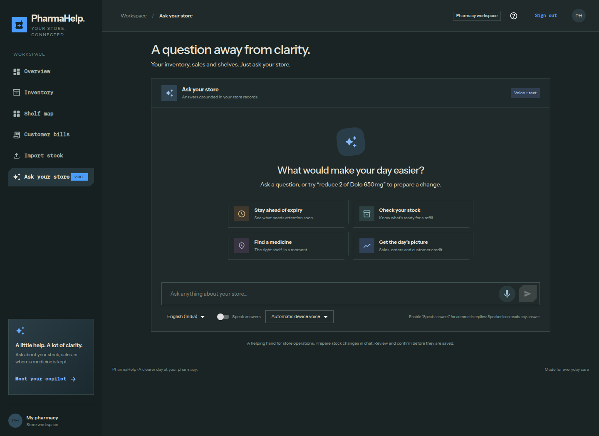
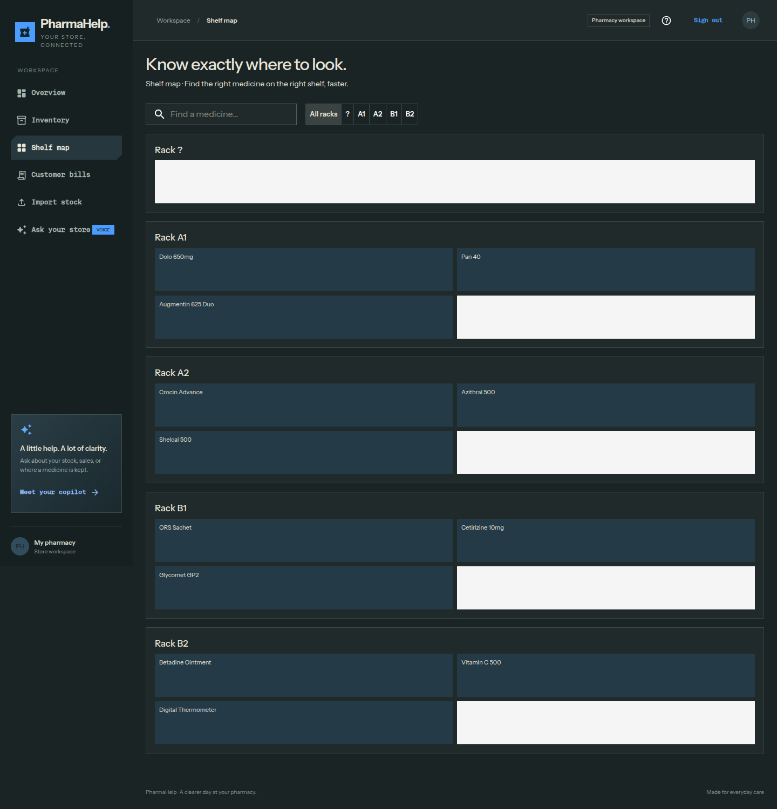
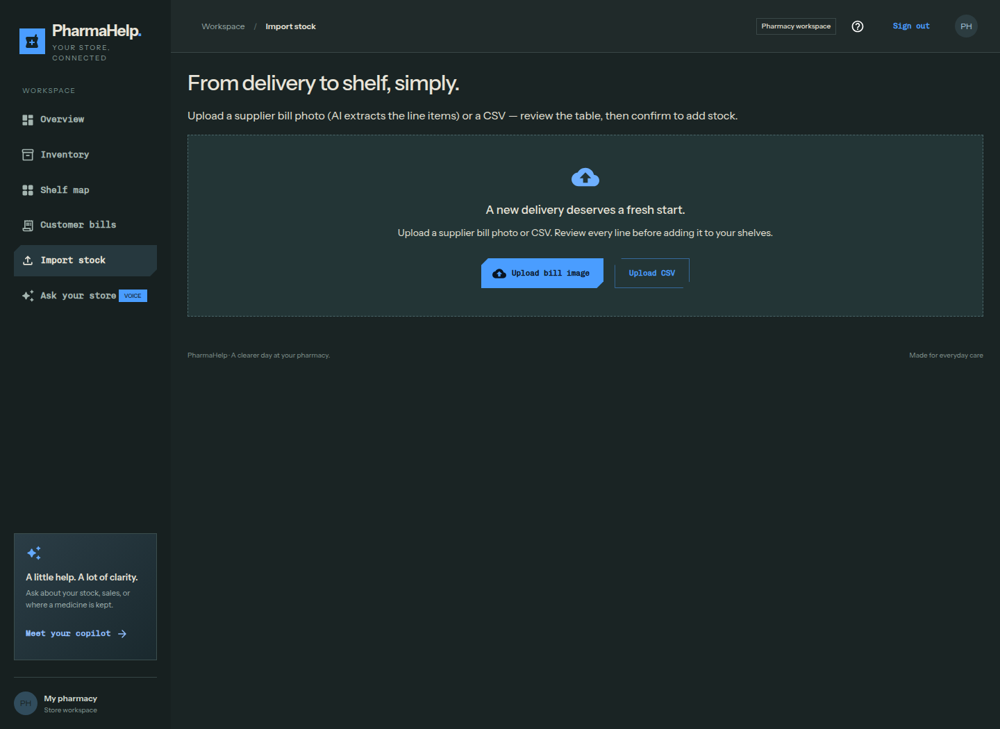
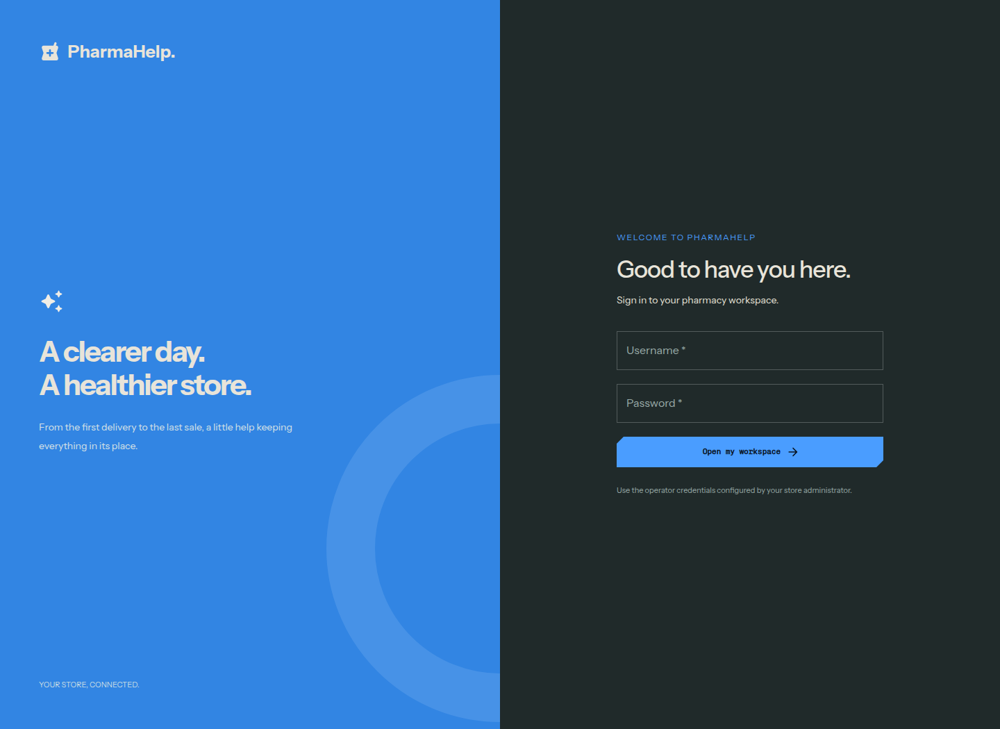

# PharmaHelp

The actual pharmacy application: a responsive Next.js interface, authenticated server APIs, a persistent SQLite database, inventory CRUD, supplier bills, customer sales, and voice-assisted store questions.

**The sample data is inside the real server database.** There is no separate dummy site, browser-local database, or read-only imitation. The same screens and APIs work with sample records and with records you create. Your writes persist across reloads, devices, and server restarts when the server’s data directory is stored on a persistent disk.

## Screenshots

These screenshots show the actual application against a disposable server-side SQLite database containing fictional records.



| Inventory | Voice assistant |
|---|---|
|  |  |

| Shelf map | Supplier import |
|---|---|
|  |  |

<details>
<summary>Login and mobile screens</summary>




</details>

## Run locally

Install Python 3.10+, Node.js 24, and npm:

```sh
npm ci
python3 manage.py init
python3 manage.py dev
```

Open http://localhost:3000. Sign in as `admin` using `APP_PASSWORD` from `.env`.

`init` generates a private `.env` with a random operator password and session secret. It never overwrites an existing file. SQLite creates its schema automatically. No database server, MongoDB account, browser database, or API key is required.

By default, `SEED_SAMPLE_DATA=true` populates an **empty** store with 12 fictional medicines and 30 historical sales. It never resets an existing store or duplicates the seed on restart. The normal inventory, sales, CSV import, and AI-confirmation endpoints operate on these records.

To start with an empty real store, set `SEED_SAMPLE_DATA=false` before creating a new database. Turning it off later preserves existing sample records; it does not delete anything.

## Run with Docker

Install Python and Docker Compose v2:

```sh
python3 manage.py init
python3 manage.py up
```

The application runs on http://localhost:3000. A named Docker volume stores `/data/pharmahelp.sqlite` and its SQLite WAL files. Restarting or rebuilding the container preserves this volume.

```sh
python3 manage.py logs
python3 manage.py status
python3 manage.py down
```

`docker compose down -v` erases the database volume. Ordinary `down` preserves it.

## Deploy the actual product from GitHub

GitHub stores the source and runs CI. The live Next.js server needs a host with a persistent disk. **GitHub Pages cannot run this backend.** The former static Pages edition has been removed.

The included [Render Blueprint](render.yaml) deploys the actual Docker application with a 1 GB persistent disk and generates the operator password and session secret. No external database service is needed. It selects a paid Starter instance and persistent storage; review the prices shown by Render.

1. Commit and push this repository to GitHub.
2. In Render, connect your GitHub account and create a **Blueprint** from this repository.
3. Confirm the service configuration and deploy it.
4. Open the service URL and sign in as `admin`. Retrieve `APP_PASSWORD` from the service’s Environment settings.
5. Put configuration under **Environment Variables → Add from .env**, or upload a Secret File named exactly `.env`; Docker also loads `/etc/secrets/.env` at runtime. Existing environment variables take precedence over that file. Save and redeploy after changing settings.
6. Optionally add `OPENAI_API_KEY` to enable natural-language AI, image extraction, and server audio, then redeploy.

The Blueprint enables automatic deployments **after GitHub CI checks pass**. Subsequent pushes rebuild the same application. The persistent disk retains SQLite data across deployments. See [Render’s Blueprint reference](https://render.com/docs/blueprint-spec) and [persistent disk guide](https://render.com/docs/disks).

For another Docker host, use the same image, mount persistent storage at `/data`, set the required secrets, and put an HTTPS reverse proxy in front of the app. Run one application instance against this SQLite file. Do not share it across multiple hosts or use ephemeral serverless storage. This SQLite configuration intentionally rejects Vercel deployment because its local filesystem is not a durable shared database.

## Configuration

See [.env.example](.env.example). Never commit `.env`, passwords, API keys, or database files.

| Variable | Purpose |
|---|---|
| `DATABASE_PATH` | Server SQLite path. Local default: `data/pharmahelp.sqlite`; Docker: `/data/pharmahelp.sqlite` |
| `SEED_SAMPLE_DATA` | `true` seeds fictional records only when the store is empty |
| `STORE_ID` | Positive store identifier; default `1` |
| `APP_USERNAME` | Operator login name |
| `APP_PASSWORD` | Operator password; at least 16 characters in production |
| `AUTH_SECRET` | Independent random session-signing secret; at least 32 characters |
| `APP_ORIGIN` | Public HTTPS URL, if needed behind a proxy; localhost HTTP is allowed locally |
| `PORT` | Local HTTP port; default `3000` |
| `OPENAI_API_KEY` | Optional natural-language answers, bill-photo extraction, transcription, and generated speech |
| `OPENAI_TRANSCRIPTION_MODEL` | Optional transcription model; default `gpt-transcribe` |
| `OPENAI_SPEECH_MODEL` | Optional speech model; default `gpt-4o-mini-tts` |

For existing `.env` files from earlier versions, replace old MongoDB/demo settings with `DATABASE_PATH` and `SEED_SAMPLE_DATA`. Keep your password and `AUTH_SECRET`. Existing MongoDB or browser-local records are not automatically imported into SQLite.

Generate a session secret with:

```sh
python3 -c 'import secrets; print(secrets.token_urlsafe(48))'
```

## Inventory and bills

**Inventory → New stock** adds a medicine, batch, quantity, price, expiry, and rack. Existing rows provide **Add**, **Reduce**, **Count**, and **Delete** actions. Count records an exact physical count. Delete zeros stock and preserves the movement history.

**Shelf map** groups medicines by rack and supports name search. **Customer bills** lists saved sales and outstanding credit. Sales can be created through the assistant’s confirmation flow or the authenticated orders API.

### CSV supplier import

Open **Import stock**, upload a CSV, review the editable rows, then confirm:

```csv
name,pack,batch,expiry,qty,mrp,purchase
Dolo 650mg,strip of 15,DL-2408,2028-06-30,20,32.50,24.00
"Medicine, with comma",strip of 10,B-12,2028-08-31,10,50.00,35.00
```

Use positive integer quantities, nonnegative prices, and `YYYY-MM-DD` expiry dates. Quoted commas are supported. Uploads are limited to 3 MB and 1,000 rows. The reviewed bill has an idempotency key to prevent duplicate processing on retry. Image extraction requires `OPENAI_API_KEY`; CSV imports do not.

## AI database operations

All modes query the actual server database. Without an API key, the deterministic router supports:

```text
What expires in the next 90 days?
What is low on stock?
Where is Dolo 650mg kept?
Stock of Dolo 650mg
Today's revenue and udhaar
Add 20 Dolo 650mg at MRP 32.50
Reduce 2 of Dolo 650mg
Set stock of Dolo 650mg to 50
Remove all stock of Dolo 650mg
Sell 2 of Dolo 650mg to Sample Customer
```

With `OPENAI_API_KEY`, the model can search records and prepare changes from more flexible language. It receives validated tools, not an unrestricted SQL connection.

Every AI write first appears as a review card. **Confirm change** commits the stock operation and its saved confirmation result in one SQL transaction. Repeating confirmation returns the saved result. Proposals expire after 15 minutes. Ambiguous medicine batches require clarification. The audit trail remains server-side.

## Voice input and spoken answers

1. Select English (India) or हिन्दी.
2. Tap the microphone, allow access, and review the recognized text before sending.
3. Enable **Speak answers** for automatic spoken replies; it is off by default.
4. Tap **Read answer aloud** on an answer to play it manually.
5. Choose an installed voice from the voice selector, or **AI voice** if configured.
6. Use **Stop audio** to stop preparation or playback.

The playback implementation waits for delayed device voices, keeps utterances alive, resumes paused synthesis, splits long answers, and reports errors instead of failing silently.

If sound does not play, check device volume/output, tab mute, and the selected voice. Some browsers block automatic audio; tap the answer’s speaker button. Some Linux/minimal environments have no speech voices installed; install a device voice or configure `OPENAI_API_KEY` for generated audio. Browser voices and server-generated audio are separate options. AI audio is disclosed in the interface and sends answer text to OpenAI.

Microphone access requires HTTPS or localhost and browser permission. Browser recognition support and installed Hindi voices vary by device. Audio recording/transcription provides a server fallback on browsers without speech recognition when an API key is configured. OpenAI usage is billed separately.

## SQL schema and reliability

The complete schema is committed at [db/schema.sql](db/schema.sql). SQLite runs on the server using Node’s built-in driver. Tables include medicines, stock movements, orders, supplier bills, proposed/confirmed actions, agent runs, rate-limit buckets, and seed metadata.

- Prepared statements bind user input.
- Stock writes, sales, imports, and AI approvals commit atomically.
- Transactions execute synchronously to avoid requests entering another request’s uncommitted transaction.
- Duplicate sale lines are consolidated before availability checks.
- Stock cannot become negative through supported operations, and expired medicine sales are rejected.
- Prices and totals are stored as integer paise.
- WAL mode and a busy timeout support the single-instance deployment.
- Signed HTTP-only sessions expire after eight hours; rotating credentials invalidates them.
- Login and paid AI/audio operations have database-backed rate limits.
- Production refuses access when credentials or session configuration are incomplete.
- `/api/health` checks configuration and SQLite readiness.

This is a single-store product with a shared operator account. It does not yet provide individual staff roles, per-person audit identity, multi-host scaling, or managed offsite backups. Validate billing rules before operational use: tax remains fixed at 12%, and dashboard days use UTC. “Sample SQL” means fictional initial records in the real backend; it does not imply that storage, authentication, or CRUD are simulated.

## Backups and recovery

For a local Node deployment:

```sh
python3 manage.py backup --output pharmacy-backup.sqlite
```

The Python CLI uses SQLite’s online backup API and refuses to overwrite an existing destination. For Docker/Render, create an online SQLite backup on the mounted disk, then download it. Do not copy only the live `.sqlite` file while WAL writes are active.

Example with Node.js 24 in the Docker container:

```sh
docker compose exec app node -e 'const {DatabaseSync,backup}=require("node:sqlite"); const db=new DatabaseSync(process.env.DATABASE_PATH); backup(db,"/data/pharmacy-backup.sqlite").then(()=>db.close())'
docker compose cp app:/data/pharmacy-backup.sqlite ./pharmacy-backup.sqlite
```

Keep offsite copies. To restore, stop application writes, preserve the existing database and WAL files, restore the verified backup to `DATABASE_PATH`, and restart. Test this on a separate disposable deployment before relying on it.

## Commands and tests

```sh
npm run typecheck
npm test
python3 -m unittest discover -s tests -p 'test_*.py'
npm audit --omit=dev
npm run build
npm run test:e2e
```

Backend tests use a disposable SQLite path ending in `_test.sqlite`; the default is `/tmp/pharmahelp_test.sqlite`. They do not require a database service. Browser tests need a running app with sample records, dedicated credentials, and `AUTH_SECRET`. CI provisions these automatically and validates stock transactions, rollback, seed idempotency, AI confirmation, sessions, rate limiting, imports, mobile navigation, and voice failure handling.

Other useful commands:

```sh
python3 manage.py setup-db  # Create/verify schema; preserve records
python3 manage.py build     # Build the standalone server
python3 manage.py start     # Serve the production build
ALLOW_DEMO_SEED=true npm run db:seed  # Populate an empty store only
```

Production and development builds use separate directories to prevent asset collisions. `scripts/prepare-standalone.mjs` packages static assets and the SQL schema with the actual server.

## Regenerate screenshots

Run the actual app against a disposable sample database, then:

```sh
SCREENSHOT_URL=http://127.0.0.1:3103 \
APP_USERNAME=test \
APP_PASSWORD=your-test-password \
node scripts/capture-screenshots.mjs
```

The script captures the login, dashboard, inventory, shelves, import, voice assistant, and mobile screens. It never captures the password field filled in. Commit `docs/screenshots/` so images render in GitHub.

## Repository map

```text
app/                         Actual pages and authenticated API routes
components/                  Theme, navigation and spoken-answer playback
db/schema.sql                Server-side SQLite schema
db/sqlite.ts                 Connection and atomic transaction handling
db/seed.ts                   Idempotent fictional initial records
lib/                         Validation, SQL queries, stock operations and AI tools
manage.py                    Dependency-free Python run/backup commands
Dockerfile / compose.yaml    Actual app with a persistent SQL volume
render.yaml                  GitHub-connected deployment with a persistent disk
.github/workflows/ci.yml     Checks before deployment
docs/screenshots/            Actual-product screenshots using fictional records
tests/                       SQL, security, Python and browser tests
```

## Troubleshooting

| Symptom | Check |
|---|---|
| Login returns 503 | Configure a 16+ character password and 32+ character `AUTH_SECRET` |
| Database will not open | Confirm `DATABASE_PATH` exists on a writable persistent directory |
| Records disappear after deployment | Attach the persistent disk and keep the same database path |
| Sample records are missing | `SEED_SAMPLE_DATA` must be true before initializing an empty store |
| Sample seed runs again | It refuses to add data to any nonempty store; check that you are using the same file |
| API returns 429 | Wait for the `Retry-After` interval |
| Spoken replies are silent | Check Speak answers, device voices, volume, and browser autoplay restrictions |
| GitHub Pages shows an old dummy version | Disable the old Pages deployment; use the actual server’s live URL |
| Vercel deployment is rejected | SQLite needs a persistent host; use the provided Docker/Render setup |

Push this complete repository, connect it to the persistent host once, and deploy the actual application. A GitHub commit alone cannot provide a running backend or durable server database.
